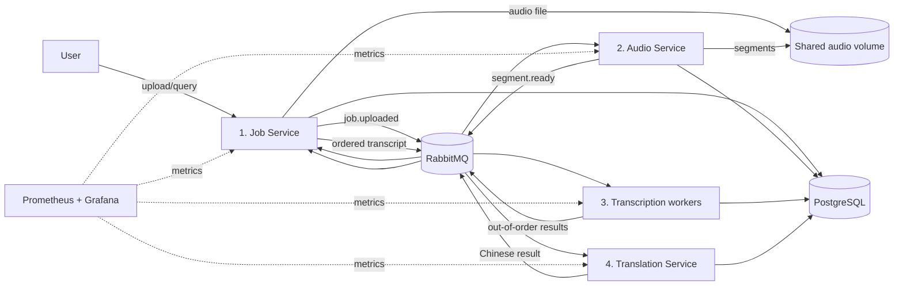

# Audio Transcription and Translation System

An Option B distributed system that accepts an English audio file (up to 30 minutes), transcribes its segments in parallel, reassembles them, and translates the final transcript into Simplified Chinese.

The default setup uses deterministic simulated AI, so the complete distributed workflow can be developed and demonstrated without paid APIs or a powerful laptop. Real local Whisper and Ollama adapters are included as optional upgrades.

## Quick start

Requirements: Docker Desktop and Docker Compose.

```bash
docker compose up --build
```

Then open:

- Application: http://localhost:8000
- Dashboard: http://localhost:3000/d/audio-pipeline (anonymous viewer; admin/admin for editing)
- RabbitMQ: http://localhost:15672 (guest/guest)
- Prometheus: http://localhost:9090

Run an end-to-end smoke test in another terminal:

```bash
chmod +x scripts/smoke_test.sh
./scripts/smoke_test.sh
```

Reset all local data if needed:

```bash
docker compose down -v
```

## Architecture



RabbitMQ carries small JSON events and file references only. Audio is stored once on a Docker shared volume. PostgreSQL stores state and idempotency records.

## Four balanced services

| Service and owner | Main implementation | Distributed-systems point for viva |
|---|---|---|
| Job Service — Cao, Mingshu | Upload API/UI, validation, job state, outbox/inbox, ordering, overlap removal, final result | State ownership, consistency and transactional outbox |
| Audio Service — Zhang, Zhexi | Validate 30-minute PCM WAV limit, segment with 0.5 s overlap, shared-volume files, publish tasks | Back-pressure, file references, idempotent segmentation |
| Transcription Service — Yokoi, Yuki | Worker pool, model adapter, retries, result cache, processing metrics | Competing consumers, redelivery and `(job_id, segment_number)` idempotency |
| Translation Service — Liu, Yingqi | English-to-Chinese adapter, timeout, retry, circuit breaker, token/time metrics | Resilient AI call, degraded result when translation is unavailable |

All four services are independently deployable containers. PostgreSQL, RabbitMQ, a shared audio volume and monitoring are infrastructure, not extra application services.

## Main decisions

- Job states: `QUEUED`, `TRANSCRIBING`, `TRANSLATING`, `DONE`, `PARTLY_DONE`, `FAILED`.
- Segments may finish out of order. Job Service stores them by segment number and only assembles after all outcomes arrive.
- After three total attempts, a failed segment becomes a visible timestamped gap. Other segments continue, producing `PARTLY_DONE`.
- A 0.5-second overlap reduces cut words. Job Service removes repeated boundary words when assembling.
- A worker crash causes RabbitMQ redelivery. A unique result key prevents duplicate data; a cached result may safely be published again.
- Maximum input is 30 minutes and 200 MB. At 20 active jobs, uploads receive HTTP 429 with a busy message.
- Translation timeout is 180 seconds. After repeated failures, the circuit opens for 30 seconds. The user still receives the English transcript, labelled `PARTLY_DONE`, and may retry translation.
- Job settings and each segment result are strongly consistent inside one database transaction. Status propagation between services is eventually consistent.

## AI and Option B

- Every result stores its transcription model version, translation model version and prompt version.
- AI output is treated as non-deterministic. Idempotency returns the first stored result for the same model version instead of silently replacing it.
- The dashboard records processing time, transcription real-time factor and translation token counts. Local/simulated AI has monetary cost `€0`; compute time is the measured cost.
- The simulated provider does not use prompts, so prompt injection is not applicable. The optional Ollama adapter wraps transcript text as untrusted data, instructs the model to ignore embedded instructions and exposes no tools. This reduces but does not eliminate the risk.

The simulator validates the architecture but not model accuracy. Evaluation of real AI must use the optional providers before the final demonstration.

## Optional real local AI

For real transcription, set these values in `.env` and rebuild the larger image:

```bash
INSTALL_LOCAL_AI=true
TRANSCRIPTION_PROVIDER=faster_whisper
TRANSLATION_PROVIDER=ollama
```

Then run:

```bash
docker compose up --build
```

The first real transcription downloads Whisper `base` into the persistent `whisper-models` volume. It is free but can be slow on CPU.

For real translation, install and start Ollama on the host, pull `qwen2.5:3b`, then run:

```bash
TRANSLATION_PROVIDER=ollama docker compose up
```

Do not depend on the network during the assessed demo: download models beforehand.

## Failure demonstrations

Inject one permanently failed segment:

```bash
FAIL_SEGMENT_NUMBER=1 docker compose up --build
```

The final transcript contains a timestamped gap and the job is `PARTLY_DONE`.

Force translation failure:

```bash
TRANSLATION_FORCE_FAILURE=true docker compose up --build
```

The transcript remains available, the job becomes `PARTLY_DONE`, retries appear in the queue, and the circuit metric changes. Remove the flag and use `POST /jobs/{id}/retry-translation`.

Kill a transcription worker while a job runs:

```bash
docker compose kill transcription-service
docker compose up -d transcription-service
```

RabbitMQ redelivers unacknowledged work. The unique key prevents duplicate results.

## Tests

```bash
python3 -m pip install -r requirements-dev.txt -r translation_service/requirements.txt
pytest
```

See [docs/requirements.md](docs/requirements.md), [docs/plan-zh.md](docs/plan-zh.md), and [docs/adrs/ADR-001-worker-redelivery.md](docs/adrs/ADR-001-worker-redelivery.md).
