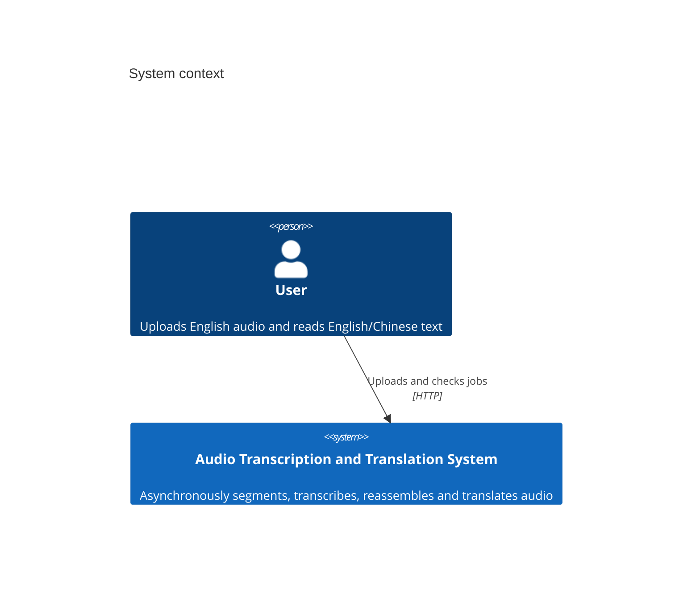
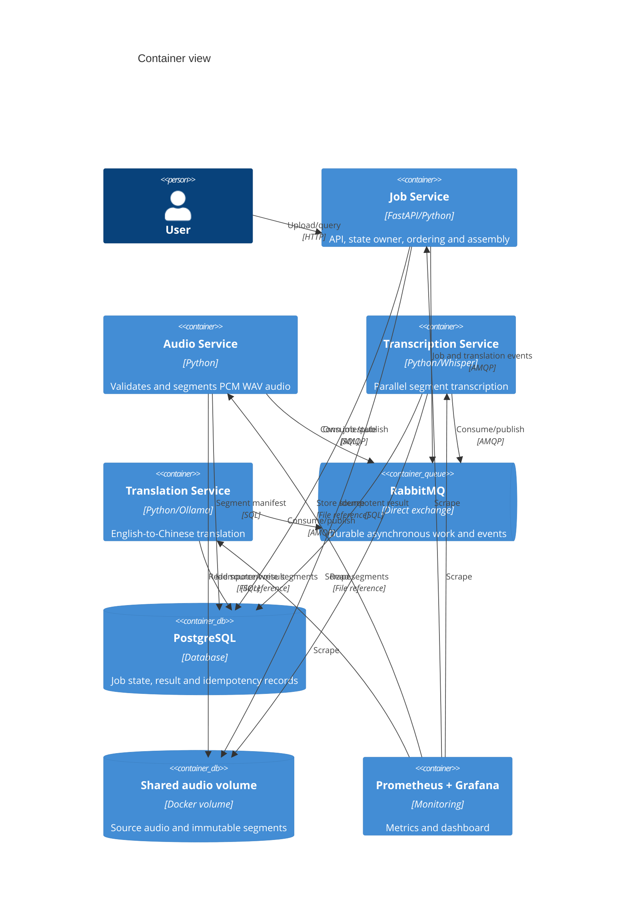
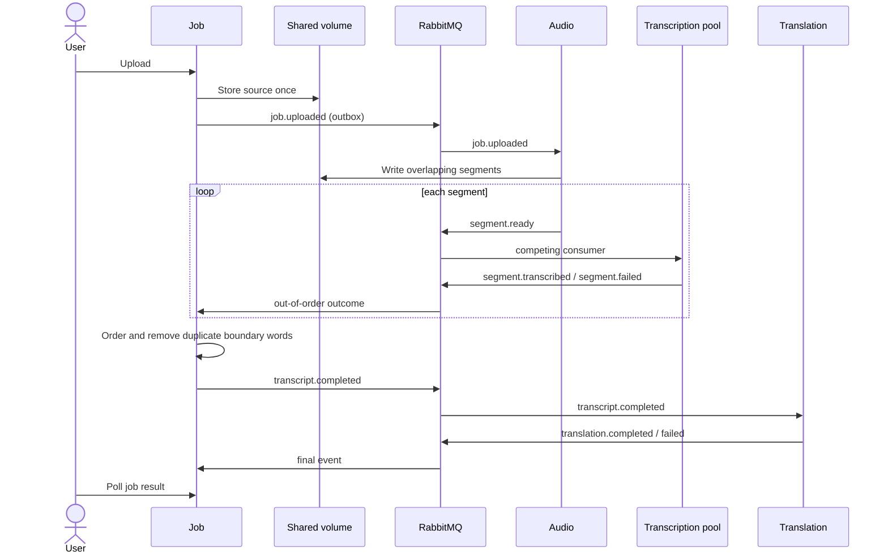

# Architecture diagrams

## C4 system context

The assessed setup has no paid external system. Optional local Whisper and Ollama models run on the same machine.

## C4 containers

## Processing sequence

